<div align="center">

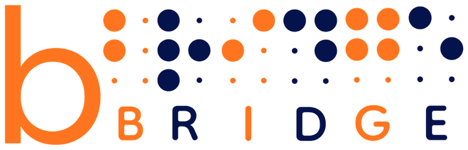

# BrailleBridge (BB1)

**Open-Source Bilingual English & Bharati Bangla Wireless Mechanical Braille Chording System**

*Hardware v3 · BB1 Wiring Board PCB v4 · Decode-on-Release ESP32 Firmware · PyQt6 Desktop Teacher Suite · Kotlin Jetpack Compose Android App · Web Bluetooth & Web Serial Console*

<p>
  <a href="https://github.com/solez-ai/braille.bridge/actions/workflows/android-release.yml"></a>
  <a href="https://www.gnu.org/licenses/gpl-3.0"></a>
  <a href="https://brailebridge.vercel.app/"></a>
  <a href="https://solez-ai.mintlify.app"></a>
</p>

<p>
  
  
  
  
  
  
</p>

<p>
  <a href="https://brailebridge.vercel.app/"><strong>Live Web Application</strong></a> ·
  <a href="https://solez-ai.mintlify.app"><strong>Technical Documentation</strong></a> ·
  <a href="https://github.com/solez-ai/braille.bridge/releases/latest"><strong>Download Desktop EXE & Android APK</strong></a> ·
  <a href="hardware/bb1_wiring_board_v4/exports/jlcpcb_gerbers_v4.zip"><strong>JLCPCB Gerber Package (v4)</strong></a> ·
  <a href="BrailleBridge_Technical_Documentation.pdf"><strong>Engineering Monograph (PDF)</strong></a>
</p>

<br />

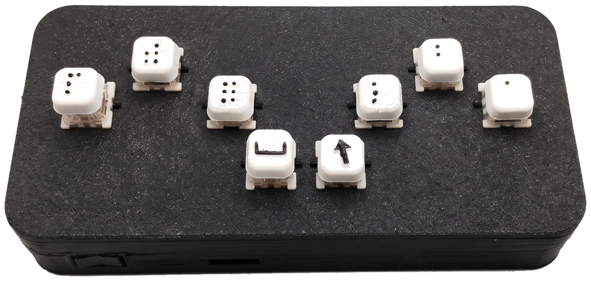

</div>

---

## Table of Contents

1. [Executive Overview](#1-executive-overview)
2. [Comparative Benchmark Against Legacy Assistive Systems](#2-comparative-benchmark-against-legacy-assistive-systems)
3. [Institutional Field Testing & Validation](#3-institutional-field-testing--validation)
   - [3.1 BERDO — Blind Education and Rehabilitation Development Organization](#31-berdo--blind-education-and-rehabilitation-development-organization)
   - [3.2 University of Dhaka — Resource Centre for the Visually Impaired Students (Co-Sponsored by Sightsavers)](#32-university-of-dhaka--resource-centre-for-the-visually-impaired-students-co-sponsored-by-sightsavers)
4. [Mechanical Hardware & 3D-Printed Wedge Enclosure (v3)](#4-mechanical-hardware--3d-printed-wedge-enclosure-v3)
   - [4.1 Physical Layout & Ergonomic Geometry](#41-physical-layout--ergonomic-geometry)
   - [4.2 Multi-Angle Hardware Gallery](#42-multi-angle-hardware-gallery)
   - [4.3 Bill of Materials (BOM) & Direct GPIO Architecture](#43-bill-of-materials-bom--direct-gpio-architecture)
5. [Custom Commercial PCB — BB1 Wiring Board v4 (KiCad 10)](#5-custom-commercial-pcb--bb1-wiring-board-v4-kicad-10)
   - [5.1 Raytraced 3D Renders & 2D Copper Composite](#51-raytraced-3d-renders--2d-copper-composite)
   - [5.2 Full KiCad 10 Schematic Diagram](#52-full-kicad-10-schematic-diagram)
   - [5.3 Dual-Mode Buck-Boost Power Architecture & Global Manufacturing Flexibility](#53-dual-mode-buck-boost-power-architecture--global-manufacturing-flexibility)
   - [5.4 Physical Stackup, Netlist Verification & Pin Allocation](#54-physical-stackup-netlist-verification--pin-allocation)
6. [ESP32 Firmware & Chording State Machine](#6-esp32-firmware--chording-state-machine)
   - [6.1 Six-Dot Bitmask Encoding](#61-six-dot-bitmask-encoding)
   - [6.2 Decode-on-Release Algorithm & Temporal Guards](#62-decode-on-release-algorithm--temporal-guards)
   - [6.3 Dual-Transport ASCII vs. Multi-Byte UTF-8 Rule](#63-dual-transport-ascii-vs-multi-byte-utf-8-rule)
   - [6.4 Structured Telemetry & Host Command Protocol](#64-structured-telemetry--host-command-protocol)
7. [Bilingual Grade 1 English & Bharati Bangla Dictionaries](#7-bilingual-grade-1-english--bharati-bangla-dictionaries)
8. [Multi-Platform Software Ecosystem](#8-multi-platform-software-ecosystem)
   - [8.1 System Architecture](#81-system-architecture)
   - [8.2 Native Desktop Teacher Suite (Python / PyQt6 / Bleak / WinRT / PySerial)](#82-native-desktop-teacher-suite-python--pyqt6--bleak--winrt--pyserial)
   - [8.3 Android Companion Application (Kotlin 2.2 / Jetpack Compose / Room)](#83-android-companion-application-kotlin-22--jetpack-compose--room)
   - [8.4 Web Platform, Interactive 3D/2D PCB Inspector & Virtual Chord Pad](#84-web-platform-interactive-3d2d-pcb-inspector--virtual-chord-pad)
9. [Repository Structure](#9-repository-structure)
10. [Build, Flash & Fabrication Guide](#10-build-flash--fabrication-guide)
11. [License & Citation](#11-license--citation)

---

## 1. Executive Overview

Across South Asia and the developing world, visually impaired students face a severe Structural Scribal Dependency during high-stakes public and university examinations. Because traditional mechanical Perkins Braillers produce embossed paper scripts that sighted examiners cannot read—and commercial refreshable Braille displays cost between **$1,500 and $3,500+ USD**—students are forced to dictate answers verbally to human scribes. A human scribe filters the student's literacy, spelling accuracy, mathematical notation, and pacing through a third party.

**BrailleBridge (BB1)** eliminates scribal dependency for less than **$15 USD** in total hardware cost (**~$11.70 USD** in raw components).

1. **Tactile Mechanical Input**: The student types standard 6-dot Braille chords on eight full-travel **Outemu Red linear mechanical switches** (`45 gf` actuation force, `2.0 mm` pre-travel, `4.0 mm` total travel, `50M`-cycle rating) housed in a tool-free, 3D-printed PLA wedge chassis with an ergonomic `7.1°` typing slope.
2. **Deterministic Decode-on-Release Engine**: An **ESP32-WROOM-32** dual-core microcontroller samples all eight switch channels directly via internal pull-up resistors (`INPUT_PULLUP`), accumulating a 6-bit chord bitmask (`0x01`–`0x3F`) across the downstroke and decoding the complete chord at the exact microsecond all keys are released (`15 ms` contact-bounce filter, live-tunable `5–50 ms`, supporting **100+ WPM** rapid chording).
3. **Bilingual Grade 1 English & Bharati Bangla**: A single `500 ms` hold of Dots `4+5+6` toggles between standard **Grade 1 English Braille** and **6-dot Bharati Bangla Braille** (স্বরবর্ণ vowels, ব্যঞ্জনবর্ণ consonants, কার dependent vowel signs via `Shift` layer, numerals `0–9`, and mathematical operators), totaling **54 base mappings** plus shifted layers.
4. **Simultaneous Sighted & Auditory Output**: Every decoded chord streams simultaneously over **Bluetooth Low Energy HID**, **BLE Nordic UART Service (NUS)**, and **USB Serial (`115200` baud)** to sighted teachers' screens (in print English, Bangla, or **128 real-time translated languages**) while local offline Text-to-Speech (`pyttsx3` / SAPI5 / Android TTS / Web Speech API) speaks every letter, word, and UI event back to the blind student.

---

## 2. Comparative Benchmark Against Legacy Assistive Systems

| Engineering Metric | Human Exam Scribe | Mechanical Perkins Brailler | Commercial Refreshable Display | **BrailleBridge (BB1 v3 / PCB v4)** |
| :--- | :--- | :--- | :--- | :--- |
| **Unit Cost (USD)** | Recurring per-exam fee | $750 – $950 USD | $1,500 – $3,500+ USD | **~$11.70 BOM (<$15 complete)** |
| **Student Independence** | None (verbal dictation) | High (embossed paper only) | High | **100% direct student authorship** |
| **Sighted Teacher Readability** | Sighted scribe handwriting | Unreadable without Braille training | Requires proprietary host software | **Instant live print text + 128-language translation** |
| **Bharati Bangla + English** | Depends on scribe fluency | Manual embossing only | Rarely supported natively | **Hardware chord toggle (`Dots 4+5+6` hold, `500 ms`)** |
| **Acoustic Noise Profile** | Verbal noise (requires isolated room) | ~75–80 dBA impact embossing | ~55 dBA piezoelectric pins | **~42 dBA silent linear switches (mainstream classroom safe)** |
| **Chording Speed Ceiling** | Limited by dictation speed | ~40–60 WPM mechanical return | ~60–80 WPM | **100+ WPM (`15 ms` decode-on-release state machine)** |
| **Power Architecture** | N/A | Purely mechanical | Proprietary sealed Li-Po pack | **USB-C + 4×AA (Direct Bypass or 5 V Buck-Boost Module)** |
| **Repairability & CAD/PCB** | N/A | Factory specialist overhaul | Sealed proprietary assembly | **100% Open-Source (GPL-3.0 STL + KiCad 10 PCB + Firmware)** |

---

## 3. Institutional Field Testing & Validation

BrailleBridge was evaluated directly in institutional environments in Dhaka, Bangladesh with visually impaired learners, university students, and assistive education pioneers.

### 3.1 BERDO — Blind Education and Rehabilitation Development Organization

Field validation was conducted at the **Blind Education and Rehabilitation Development Organization (BERDO)** headquarters in Rupnagar, Mirpur, Dhaka, under the supervision of BERDO Founder and Executive Director **Md. Saidul Huq**—recipient of the **2026 Independence Award (Swadhinata Puruskar)**, Bangladesh's highest civilian state honor, and the **2023 Ekushey Padak**. Visually impaired students and educators tested the 8-switch mechanical tactile profile, bilingual Bharati Bangla chording, and real-time voice synthesis.

<div align="center">
<table>
  <tr>
    <td align="center" width="50%">
      
      <br />
      <sub><strong>Fig 3.1a:</strong> Institutional demonstration with Md. Saidul Huq (Founder &amp; Executive Director, BERDO; 2026 Swadhinata Puruskar &amp; 2023 Ekushey Padak laureate).</sub>
    </td>
    <td align="center" width="50%">
      
      <br />
      <sub><strong>Fig 3.1b:</strong> Tactile evaluation of the 8-switch mechanical Perkins layout inside the BERDO Braille library in Mirpur, Dhaka.</sub>
    </td>
  </tr>
  <tr>
    <td align="center" width="50%">
      
      <br />
      <sub><strong>Fig 3.1c:</strong> Real-time bilingual English and Bharati Bangla chording trial with live desktop telemetry.</sub>
    </td>
    <td align="center" width="50%">
      
      <br />
      <sub><strong>Fig 3.1d:</strong> Assessing Outemu Red 45 gf actuation consistency and decode-on-release responsiveness.</sub>
    </td>
  </tr>
</table>

<p>
  <a href="https://youtu.be/4cl6KOXK6Is"></a>
</p>
</div>

### 3.2 University of Dhaka — Resource Centre for the Visually Impaired Students (Co-Sponsored by Sightsavers)

BrailleBridge was benchmarked side-by-side against mechanical Perkins Braillers at the **Resource Centre for the Visually Impaired Students** inside the **Dhaka University Central Library** (Kazi Nazrul Islam Ave, Dhaka). Established in **2007** and jointly sponsored by **Dhaka University Library** and **Sightsavers**, the Resource Centre serves visually impaired undergraduates and researchers across the university.

<div align="center">
<table>
  <tr>
    <td align="center" width="50%">
      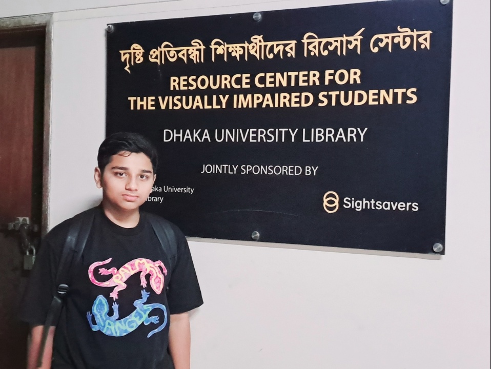
      <br />
      <sub><strong>Fig 3.2a:</strong> Resource Centre for the Visually Impaired Students at Dhaka University Central Library (Jointly Sponsored by Dhaka University Library &amp; Sightsavers).</sub>
    </td>
    <td align="center" width="50%">
      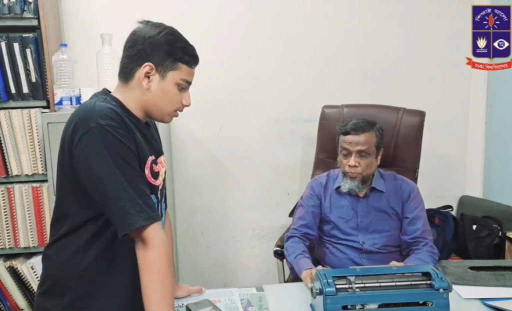
      <br />
      <sub><strong>Fig 3.2b:</strong> Direct ergonomic and acoustic benchmark of BrailleBridge BB1 alongside a mechanical Perkins Brailler at Dhaka University.</sub>
    </td>
  </tr>
  <tr>
    <td align="center" width="50%">
      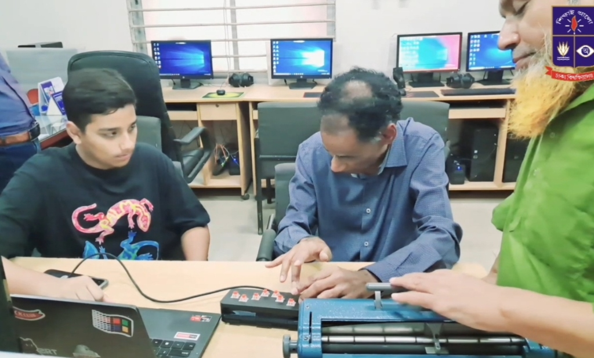
      <br />
      <sub><strong>Fig 3.2c:</strong> Visually impaired student testing wireless 6-dot chording and auditory TTS confirmation at the Dhaka University Resource Centre.</sub>
    </td>
    <td align="center" width="50%">
      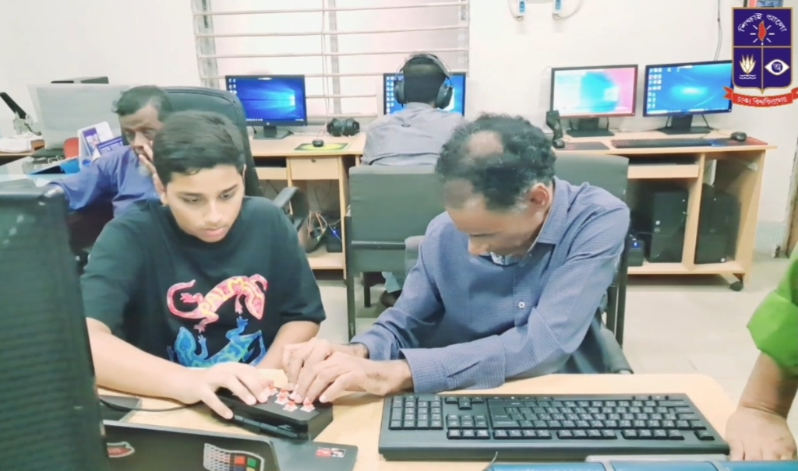
      <br />
      <sub><strong>Fig 3.2d:</strong> Guided finger-placement transition from heavy mechanical embossing levers to low-force 45 gf linear mechanical switches.</sub>
    </td>
  </tr>
</table>

<p>
  <a href="https://youtu.be/cBVkKMnPTk8"></a>
</p>
</div>

---

## 4. Mechanical Hardware & 3D-Printed Wedge Enclosure (v3)

### 4.1 Physical Layout & Ergonomic Geometry

The BB1 v3 enclosure (`180 mm × 80 mm` footprint, tapering from `30 mm` front wall height to `40 mm` rear wall height) forms a `7.1°` angled wedge engineered for neutral wrist posture during extended exam sessions. The top plate mounts **eight `14.0 × 14.0 mm` MX-compatible mechanical switch cutouts** arranged in a symmetric split-hand Perkins Braille arc:

```text
+-----------------------------------------------------------------------+
|                       REAR INTEGRATED HINGE                           |
|                                                                       |
|     [ Dot 3 ]   [ Dot 2 ]   [ Dot 1 ]   [ Dot 4 ]   [ Dot 5 ]   [ Dot 6 ]
|      GPIO 27     GPIO 14     GPIO 12     GPIO 26     GPIO 25     GPIO 33
|      (Ring L)   (Middle L)  (Index L)   (Index R)   (Middle R)  (Ring R)
|                                                                       |
|                   [ SPACE ]               [ SHIFT / BKSP ]            |
|                    GPIO 32                    GPIO 23                 |
|                   (Thumb L)                  (Thumb R)                |
|                                                                       |
|             [ SNAP LATCH L ]             [ SNAP LATCH R ]             |
+-----------------------------------------------------------------------+
```

- **Zero External Indicator LEDs**: In keeping with blind-first hardware design, the BB1 v3 architecture eliminates physical indicator LEDs and current-limiting resistor harnesses entirely. All operational feedback (character readout, backspace confirmation, language switching, capital lock state, and BLE pairing status) is delivered through multi-platform auditory speech synthesis and tactile landmarking.
- **Clamshell Serviceability**: A print-in-place rear hinge (`2.2 mm` filament/steel pin) paired with dual front snap latches allows teachers or technicians to open the top plate in seconds without removing screws.
- **Underside Tool-Free `4×AA` Battery Bay**: A drop-out bottom hatch (`120 × 62 mm`) provides immediate external access to the `4×AA` battery holder while isolating the internal PCB cavity.

### 4.2 Multi-Angle Hardware Gallery

<div align="center">
<table>
  <tr>
    <td align="center" width="50%">
      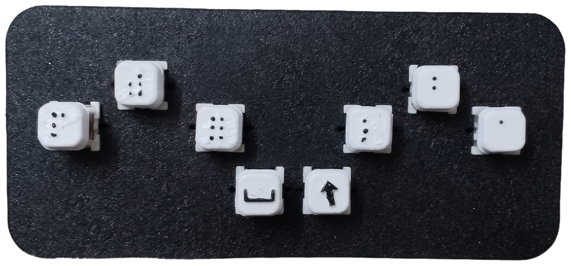
      <br />
      <sub><strong>Fig 4.2a:</strong> Top isometric render showing the 6-dot ergonomic finger arc and dual thumb modifier keys (`SPACE` and `SHIFT / BKSP`).</sub>
    </td>
    <td align="center" width="50%">
      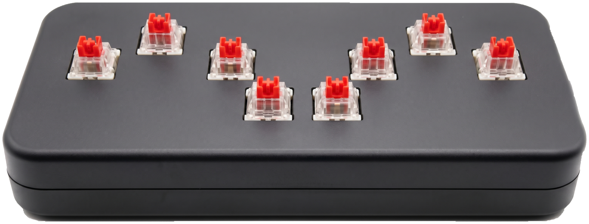
      <br />
      <sub><strong>Fig 4.2b:</strong> Front elevation detailing the Outemu Red keycap profile and dual front snap-latch seam.</sub>
    </td>
  </tr>
  <tr>
    <td align="center" width="50%">
      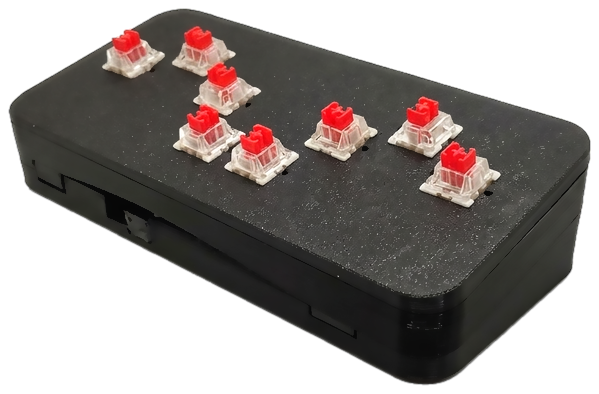
      <br />
      <sub><strong>Fig 4.2c:</strong> Quarter-angle view highlighting the `30 mm` to `40 mm` (`7.1°`) ergonomic wedge slope.</sub>
    </td>
    <td align="center" width="50%">
      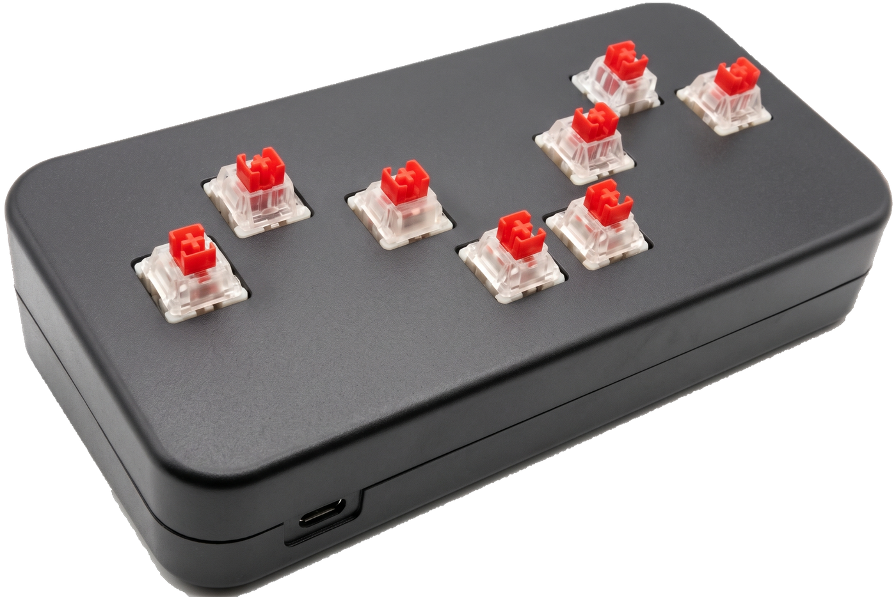
      <br />
      <sub><strong>Fig 4.2d:</strong> Close-up of the `14 × 14 mm` plate-mounted Outemu Red linear switches (`45 gf` actuation).</sub>
    </td>
  </tr>
  <tr>
    <td align="center" width="50%">
      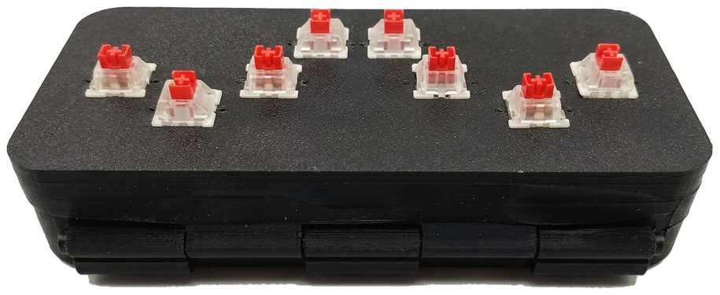
      <br />
      <sub><strong>Fig 4.2e:</strong> Rear elevation showing the 3-knuckle clamshell hinge and slide power switch cutout (`12 × 6 mm`).</sub>
    </td>
    <td align="center" width="50%">
      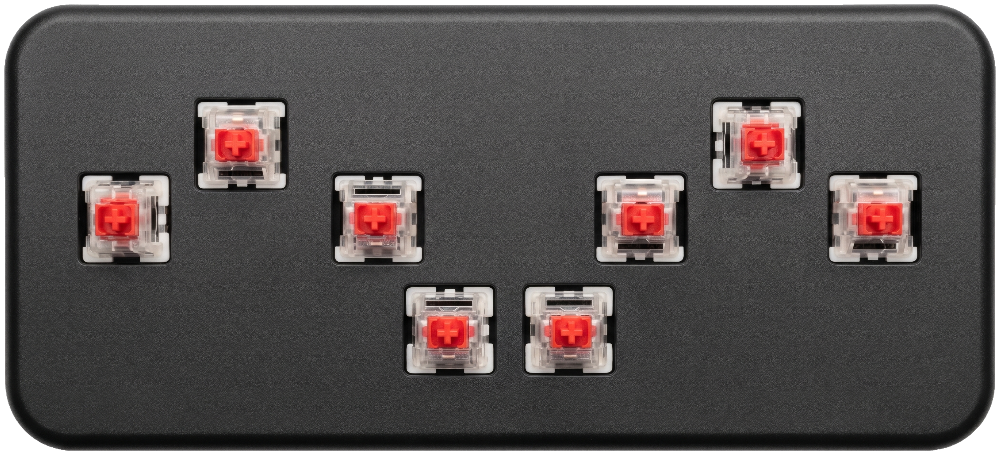
      <br />
      <sub><strong>Fig 4.2f:</strong> Orthographic top plan of the `180 × 80 mm` switch deck (`23 mm` center-to-center key spacing).</sub>
    </td>
  </tr>
  <tr>
    <td align="center" width="50%">
      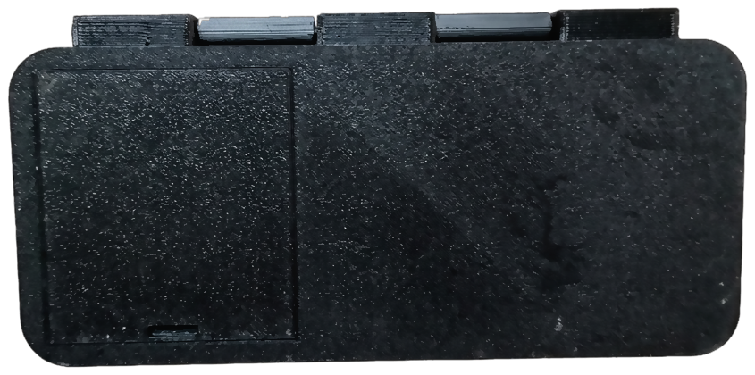
      <br />
      <sub><strong>Fig 4.2g:</strong> Underside tool-free `4×AA` drop-out battery compartment (`120 × 62 mm`).</sub>
    </td>
    <td align="center" width="50%">
      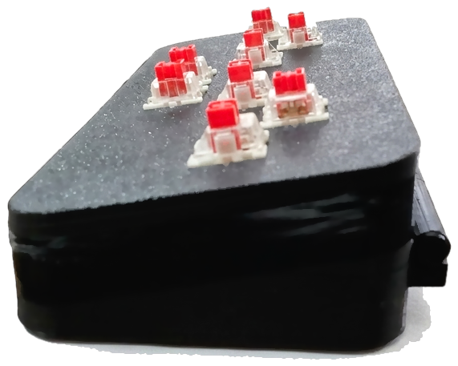
      <br />
      <sub><strong>Fig 4.2h:</strong> Left side profile showing the `14 × 8 mm` USB-C programming/serial access window.</sub>
    </td>
  </tr>
</table>
</div>

### 4.3 Bill of Materials (BOM) & Direct GPIO Architecture

Every switch is wired as a dedicated SPST normally-open contact between an ESP32 GPIO pin configured as `INPUT_PULLUP` (internal `~45 kΩ` pull-up to `3.3 V`) and the common ground plane (`GND`). Because no row/column diode multiplexing matrix is used, **8-key rollover (NKRO) is physically guaranteed with zero ghosting**.

| Switch / Module | Physical Role | Anatomical Finger | ESP32 GPIO | Active Logic | Electrical Configuration |
| :--- | :--- | :--- | :--- | :--- | :--- |
| **Dot 1 (`D1`)** | Left Column, Top Dot | Left Index | `GPIO 12` | Active-LOW (`0 V`) | Direct `INPUT_PULLUP` (`0b000001` / `0x01`) |
| **Dot 2 (`D2`)** | Left Column, Middle Dot | Left Middle | `GPIO 14` | Active-LOW (`0 V`) | Direct `INPUT_PULLUP` (`0b000010` / `0x02`) |
| **Dot 3 (`D3`)** | Left Column, Bottom Dot | Left Ring | `GPIO 27` | Active-LOW (`0 V`) | Direct `INPUT_PULLUP` (`0b000100` / `0x04`) |
| **Dot 4 (`D4`)** | Right Column, Top Dot | Right Index | `GPIO 26` | Active-LOW (`0 V`) | Direct `INPUT_PULLUP` (`0b001000` / `0x08`) |
| **Dot 5 (`D5`)** | Right Column, Middle Dot | Right Middle | `GPIO 25` | Active-LOW (`0 V`) | Direct `INPUT_PULLUP` (`0b010000` / `0x10`) |
| **Dot 6 (`D6`)** | Right Column, Bottom Dot | Right Ring | `GPIO 33` | Active-LOW (`0 V`) | Direct `INPUT_PULLUP` (`0b100000` / `0x20`) |
| **Space (`SPACE`)** | Left Thumb Key | Left Thumb | `GPIO 32` | Active-LOW (`0 V`) | Word boundary (`0x20` ASCII + `SYSTEM:SPACE`) |
| **Shift (`SHIFT`)** | Right Thumb Modifier | Right Thumb | `GPIO 23` | Active-LOW (`0 V`) | Tap = Backspace (`25–1500 ms`); Hold = Layer 2 / Caps |

#### Production Component Cost Breakdown (Single-Unit Retail)

| Item | Specification | Qty | Unit Cost (USD) | Subtotal (USD) |
| :--- | :--- | :---: | :---: | :---: |
| **Microcontroller** | 38-Pin ESP32-WROOM-32 DevKit (`ESP-WROOM-32`, BLE 4.2 + USB-UART) | 1 | $4.50 | **$4.50** |
| **Mechanical Switches** | Outemu Red Linear MX Switches (`45 gf`, `4.0 mm` travel, 3-pin) | 8 | $0.20 | **$1.60** |
| **Keycaps** | 1u OEM/DSA ABS Sculpted Keycaps (`18 × 18 mm`) | 8 | $0.10 | **$0.80** |
| **Custom Carrier PCB** | **BB1 Wiring Board v4** (`66.0 × 52.0 × 1.2 mm` 2-Layer FR-4 + Headers + `1N5819` × 2) | 1 | $1.10 | **$1.10** |
| **Enclosure Filament** | ~110 g PLA Filament (`0.20 mm` layer height, `20%` gyroid infill) | 110 g | $0.02/g | **$2.20** |
| **Power Assembly** | `4×AA` Battery Holder + SPDT Slide Switch (`SS-12D00`) + Fasteners | 1 set | $1.50 | **$1.50** |
| **Standard Build Total** | **Complete BB1 Unit (`JP1` in `1-2 AA Direct` Bypass Mode)** | — | — | **$11.70 USD** |
| *Optional Regulator* | *Pololu `S9V11F5` 5 V Buck-Boost Module (`3–16 V` in, `1.5 A` out) on Socket `J5`* | *1* | *$3.00* | *(+$3.00 optional)* |

---

## 5. Custom Commercial PCB — BB1 Wiring Board v4 (KiCad 10)

To replace hand-soldered point-to-point wiring harnesses with a deterministic, classroom-durable assembly that any local technician can solder in under ten minutes, BrailleBridge includes a complete commercial 2-layer carrier PCB engineered in **KiCad 10.0**: **`BB1 Wiring Board v4`** (`hardware/bb1_wiring_board_v4/`).

### 5.1 Raytraced 3D Renders & 2D Copper Composite

<div align="center">
<table>
  <tr>
    <td align="center" width="50%">
      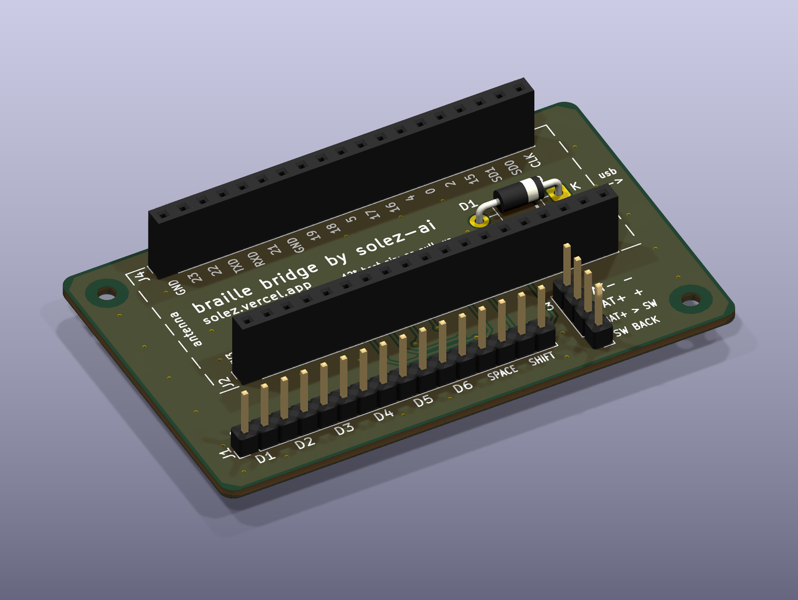
      <br />
      <sub><strong>Fig 5.1a:</strong> Raytraced 3D isometric view of BB1 Wiring Board v4 (`66.0 × 52.0 × 1.2 mm`) showing dual `1×19` ESP32 headers (`J2/J4`), `1×16` switch array (`J1`), power header (`J3`), buck-boost socket (`J5`), mode selector (`JP1`), and dual `1N5819` Schottky diodes (`D1/D2`).</sub>
    </td>
    <td align="center" width="50%">
      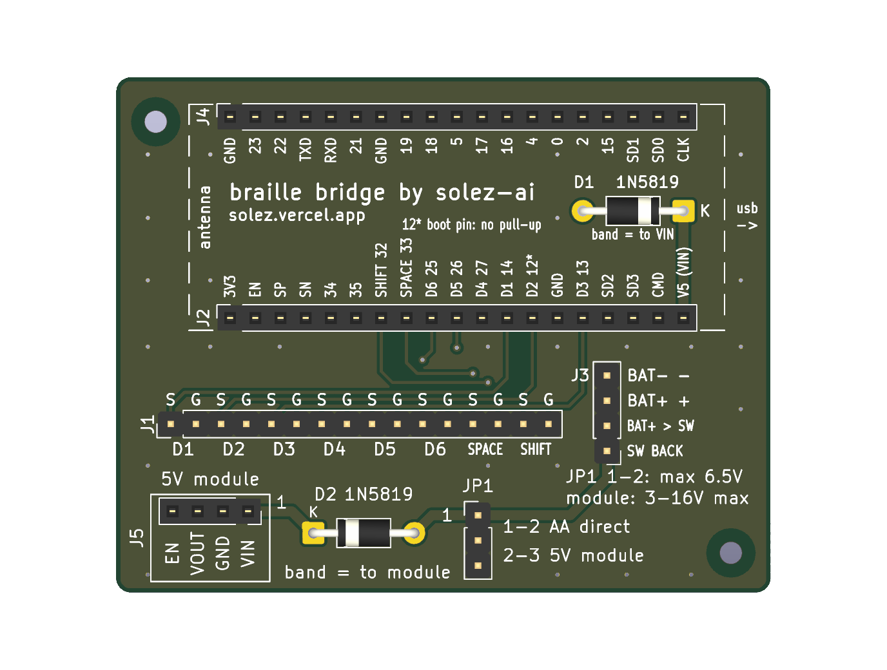
      <br />
      <sub><strong>Fig 5.1b:</strong> Top orthographic 3D render illustrating `20.300 mm` (`800 mil`) center-to-center ESP32 socket alignment, explicit pin-function silkscreen legends, and 4 corner M3 mounting bosses (`4.4 mm` keepout radius).</sub>
    </td>
  </tr>
  <tr>
    <td align="center" width="50%">
      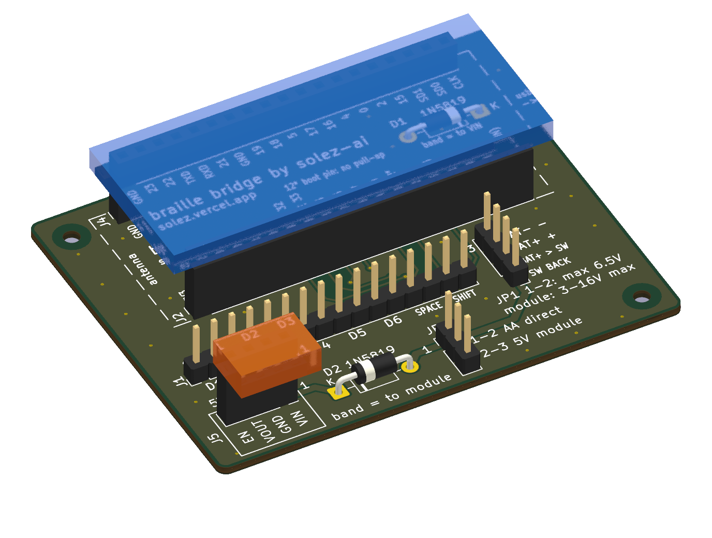
      <br />
      <sub><strong>Fig 5.1c:</strong> Oblique 3D profile highlighting the right-hand power management zone (`J3`, `J5`, `JP1`, `D1`, `D2`) isolated from the 8 high-impedance switch signal traces.</sub>
    </td>
    <td align="center" width="50%">
      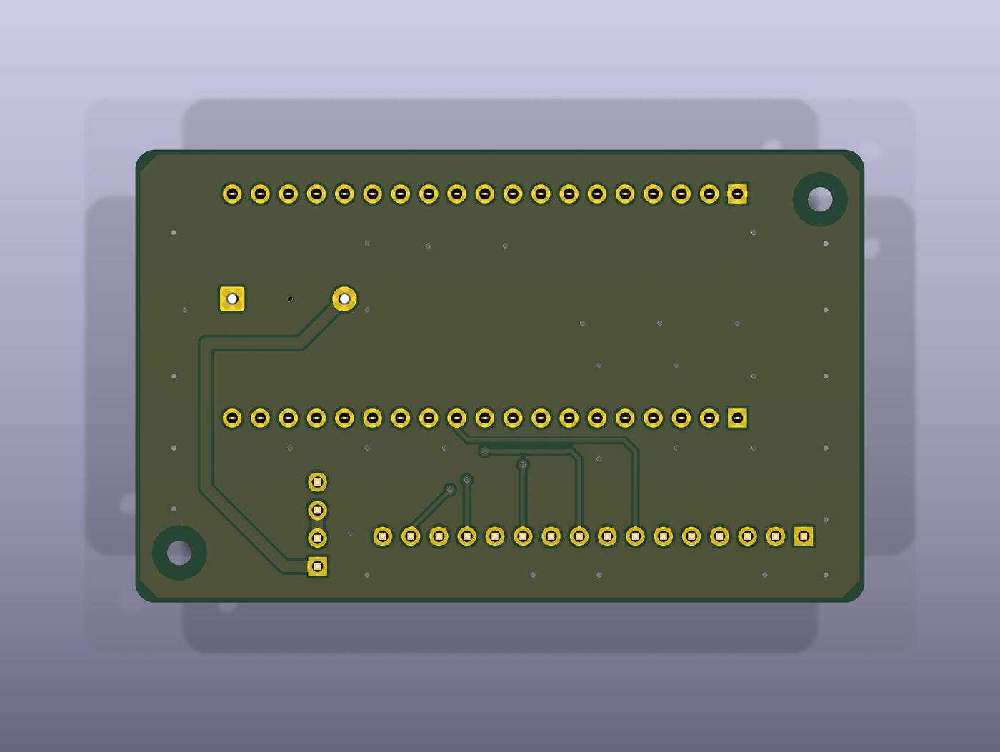
      <br />
      <sub><strong>Fig 5.1d:</strong> Bottom (`B.Cu`) 3D render showing the unbroken ground pour, `27` GND stitching vias, `1.00 mm` high-current power tracks, and through-hole thermal reliefs.</sub>
    </td>
  </tr>
</table>

<br />

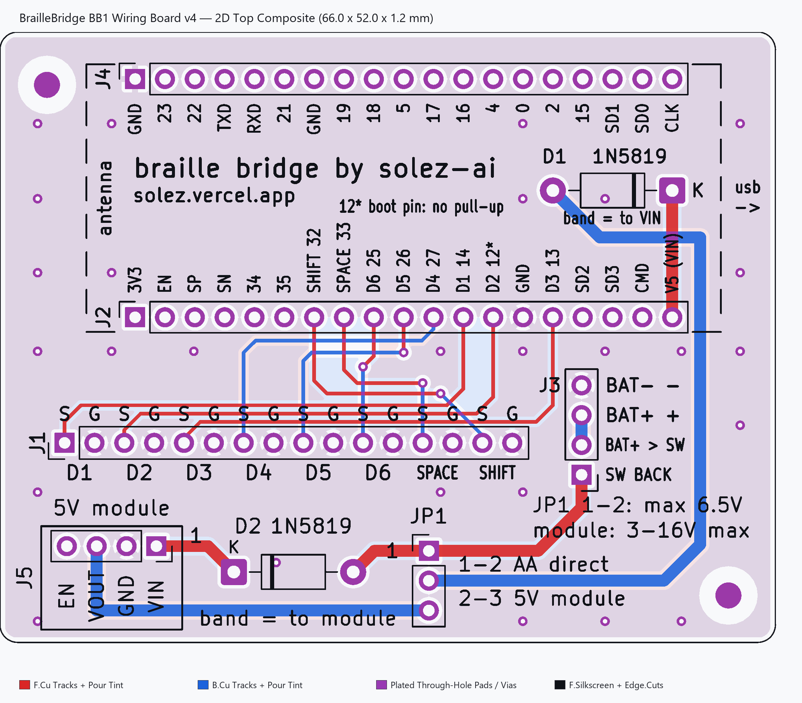
<br />
<sub><strong>Fig 5.1e:</strong> High-resolution 2D KiCad copper/silkscreen composite (`F.Cu` red, `B.Cu` blue, `F.SilkS` white, `Edge.Cuts` profile) with zero trace crossings and `0` DRC violations.</sub>
</div>

### 5.2 Full KiCad 10 Schematic Diagram

<div align="center">
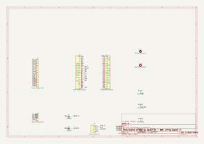
<br />
<sub><strong>Fig 5.2:</strong> Complete KiCad 10 electrical schematic (`hardware/bb1_wiring_board_v4/bb1_wiring_board_v4.kicad_sch`) passing strict Electrical Rules Check (`0` ERC errors, `0` warnings, `100%` netlist-to-PCB pin parity across all 71 pins).</sub>
</div>

### 5.3 Dual-Mode Buck-Boost Power Architecture & Global Manufacturing Flexibility

A central engineering innovation of **BB1 Wiring Board v4** is its **Dual-Mode Power Path (`J3` + `J5` + `JP1` + `D1/D2`)**, designed specifically for global assistive-technology deployment across regions with vastly different battery and component supply chains:

```mermaid
flowchart LR
    subgraph Input["External Battery Pack (J3)"]
        BAT["4xAA Pack (3.0V - 6.4V)<br/>or Single Li-Ion / 2S Pack"]
        SW["Power Switch Loop<br/>J3 Pin 1 (BAT_RAW) -> Pin 2 (BAT_SW)"]
        BAT --> SW
    end

    subgraph PowerModes["Configurable Power Architecture"]
        D2["D2: 1N5819 Schottky<br/>Direct Bypass Path"]
        J5["J5: Pololu S9V11F5 Socket<br/>5V Buck-Boost (3V - 16V In)"]
        JP1["JP1: 3-Pin Mode Selector<br/>[1-2] AA Direct vs [2-3] 5V Module"]
    end

    subgraph Protection["Reverse-Current Isolation"]
        D1["D1: 1N5819 Schottky<br/>OR-ing & USB Backfeed Guard"]
        ESP["J4 Pin 19: ESP32 5V / VIN<br/>(Internal 3.3V LDO Rail)"]
    end

    SW -->|BAT_SW| D2
    SW -->|BAT_SW -> VIN| J5
    D2 -->|V_BYPASS -> Pin 1| JP1
    J5 -->|VREG_5V -> Pin 3| JP1
    JP1 -->|Pin 2: V_MUX| D1
    D1 -->|5V_IN (1.00 mm Trace)| ESP
```

1. **Why Dual-Mode Power Exists (Global & Regional Manufacturing Flexibility)**:
   - **Mode A — `JP1` Bridged `1–2` (`AA Direct` Economy Bypass)**: In low-income rural deployments or local school workshops where imported DC-DC converter modules are unavailable or budget-constrained, bridging `JP1` pins `1–2` routes switched battery power (`BAT_SW`) through dual series **`1N5819` Schottky diodes (`D2` + `D1`)** directly into the ESP32 `5V/VIN` rail (`J4` Pin 19). Because each `1N5819` exhibits a low forward drop (`Vf ≈ 0.32–0.38 V` at `150 mA`), a fresh `4×AA` alkaline pack (`6.0–6.4 V`) is dropped by `~0.7 V` into the safe `5.3–5.7 V` operating window of the ESP32's onboard `AMS1117-3.3` LDO while providing double reverse-polarity and USB back-feed protection—at **zero regulator module cost**.
   - **Mode B — `JP1` Bridged `2–3` (`5V Module` Buck-Boost Regulation)**: When socket `J5` is populated with a **5 V Step-Up/Step-Down (Buck-Boost) regulator module** (Pololu `S9V11F5`, `3–16 V` input, `5.0 V @ 1.5 A` continuous output), the board maintains a rock-solid `5.0 V` rail even as `4×AA` alkaline cells discharge all the way down to `3.0 V` (`0.75 V/cell`), or when regional fabricators substitute `4×AA` NiMH rechargeable cells (`4.8 V` nominal), a single `18650` Li-Ion cell (`3.7 V`), or a `9 V`/`12 V` DC classroom adapter.
2. **Simultaneous USB-C + Battery Safety (`D1` Schottky OR-ing)**: Diode `D1` (`1N5819`, `40 V`, `1 A`, `DO-41`) sits between `JP1` Pin 2 (`V_MUX`) and `J4` Pin 19 (`5V_IN`), preventing the ESP32's `5 V` USB VBUS rail from back-driving current into the battery pack or regulator output when a teacher plugs in a USB-C cable for serial telemetry while batteries remain switched on.

### 5.4 Physical Stackup, Netlist Verification & Pin Allocation

| Parameter | Specification (`BB1 Wiring Board v4`) | Verification Status |
| :--- | :--- | :--- |
| **Board Dimensions** | `66.0 mm × 52.0 mm × 1.2 mm` (`2.0 mm` corner radius, 2-Layer FR-4) | JLCPCB standard 2-layer process |
| **Copper Weights & Finish** | `1 oz` (`35 µm`) outer `F.Cu` & `B.Cu`, Lead-Free HASL, Green Solder Mask | Verified in `jlcpcb_gerbers_v4.zip` |
| **Track Widths** | `1.00 mm` Power Rails (`BAT_RAW`, `BAT_SW`, `V_BYPASS`, `VREG_5V`, `V_MUX`, `5V_IN`) / `0.30 mm` Signals | Current capacity `>2.5 A` on power path |
| **Copper Zones & Vias** | Dual `GND` copper pours (`F.Cu` & `B.Cu`, `0.35 mm` clearance) + `31` vias (`27` GND stitching + `4` signal) | Low-impedance return plane under RF module |
| **Total Component Pins** | **71 Pins** across 9 components (`J1` 16p, `J2` 19p, `J4` 19p, `J3` 4p, `J5` 4p, `JP1` 3p, `D1` 2p, `D2` 2p, `R1` 2p) | `15` active copper nets (`12` GND pins) |
| **KiCad 10 ERC / DRC** | `0` ERC Errors, `0` ERC Warnings, `0` DRC Violations, `0` Unconnected Items, `0` Parity Mismatches | Verified via `kicad-cli` automated audit |

#### Complete Connector Pinout Reference

| Connector | Footprint | Pitch / Geometry | Pin-by-Pin Assignment |
| :--- | :--- | :--- | :--- |
| **`J1` (Switch Header)** | `1×16` Through-Hole (`2.54 mm`) | Paired `(Signal, GND)` per switch | `1:D1(IO12)`, `2:GND`, `3:D2(IO14)`, `4:GND`, `5:D3(IO27)`, `6:GND`, `7:D4(IO26)`, `8:GND`, `9:D5(IO25)`, `10:GND`, `11:D6(IO33)`, `12:GND`, `13:SPACE(IO32)`, `14:GND`, `15:SHIFT(IO23)`, `16:GND` |
| **`J2` (ESP32 Left Bank)** | `1×19` Female Socket (`2.54 mm`) | `X = 12.70 mm` (`20.30 mm` to `J4`) | `Pin 7 -> IO32 (SPACE)`, `Pin 8 -> IO33 (D6)`, `Pin 9 -> IO25 (D5)`, `Pin 10 -> IO26 (D4)`, `Pin 11 -> IO27 (D3)`, `Pin 12 -> IO14 (D2)`, `Pin 13 -> IO12 (D1)`, `Pin 14 -> GND` |
| **`J4` (ESP32 Right Bank)** | `1×19` Female Socket (`2.54 mm`) | `X = 33.00 mm` (`800 mil` spacing) | `Pin 1 -> GND`, `Pin 2 -> IO23 (SHIFT)`, `Pin 7 -> GND`, `Pin 13 -> GND`, `Pin 19 -> 5V_IN (VIN)` |
| **`J3` (Battery & Switch)** | `1×04` Through-Hole (`2.54 mm`) | `1.00 mm` power trace width | `Pin 1 -> BAT_RAW (Sw A)`, `Pin 2 -> BAT_SW (Sw B)`, `Pin 3 -> BAT_RAW (Battery +)`, `Pin 4 -> GND (Battery -)` |
| **`J5` (5V Buck-Boost)** | `1×04` Module Socket (`2.54 mm`) | Pololu `S9V11F5` pinout | `Pin 1 -> VIN (BAT_SW)`, `Pin 2 -> EN (Pulled up via R1 100k)`, `Pin 3 -> GND`, `Pin 4 -> VOUT (VREG_5V)` |
| **`JP1` (Mode Selector)** | `1×03` Header + Shunt (`2.54 mm`) | Selects bypass vs regulated | `Pin 1 -> V_BYPASS (1-2: AA Direct)`, `Pin 2 -> V_MUX (Common to D1)`, `Pin 3 -> VREG_5V (2-3: 5V Module)` |

---

## 6. ESP32 Firmware & Chording State Machine

The firmware (`braile/braile.ino`, `braile/BBKeyboard.h`, `braile/BBKeyboard.cpp`) runs bare-metal on the ESP32 under the Arduino/FreeRTOS core and implements a non-blocking **Decode-on-Release** chord state machine.

### 6.1 Six-Dot Bitmask Encoding

Every Braille cell consists of 6 dots arranged in 2 columns of 3 rows. The firmware packs the state of all 6 dot switches into a single `uint8_t` bitmask (`0x01` to `0x3F`, providing $2^6 - 1 = 63$ distinct non-zero combinations):

```text
      LEFT HAND                   RIGHT HAND
   +-------------+             +-------------+
   |  Dot 1 (b0) |             |  Dot 4 (b3) |      Bitmask Formula:
   |  VAL = 0x01 |             |  VAL = 0x08 |      M = (D1 << 0) | (D2 << 1) | (D3 << 2)
   +-------------+             +-------------+        | (D4 << 3) | (D5 << 4) | (D6 << 5)
   |  Dot 2 (b1) |             |  Dot 5 (b4) |
   |  VAL = 0x02 |             |  VAL = 0x10 |      Example — Bangla 'ক' / English 'A':
   +-------------+             +-------------+      Dot 1 only -> 0b000001 = 0x01 (Decimal 1)
   |  Dot 3 (b2) |             |  Dot 6 (b5) |
   |  VAL = 0x04 |             |  VAL = 0x20 |      Example — Language Toggle (Dots 4+5+6):
   +-------------+             +-------------+      0x08 | 0x10 | 0x20 = 0b111000 = 0x38 (56)
```

### 6.2 Decode-on-Release Algorithm & Temporal Guards

Unlike fixed-window timers that force slow beginners to race against a clock or cap advanced typists at a fixed cadence, BrailleBridge uses an **accumulative Decode-on-Release state machine**:

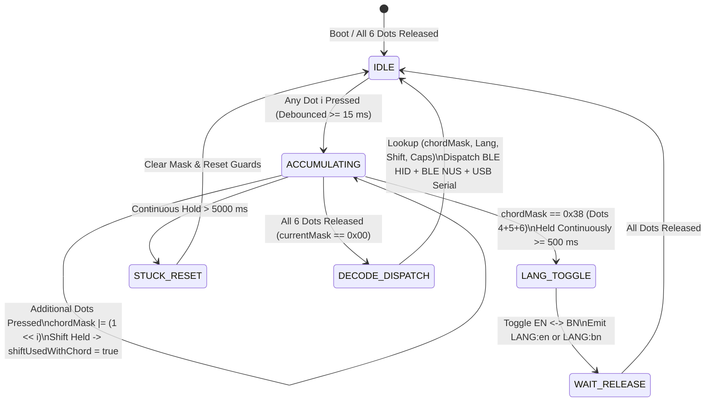

1. **Per-Key Contact Debounce (`15 ms` default, runtime-tunable `5–50 ms`)**: Each of the 8 GPIO pins maintains its own independent state tracker (`lastRawState`, `stableState`, `lastDebounceTime`). A transition is registered only after the physical pin remains stable for `debounceDelayMs` (`15 ms`), rejecting mechanical contact bounce while allowing chord rates exceeding **100+ WPM**.
2. **Chord Union Accumulation (`chordMask |= currentMask`)**: From the instant the first dot of a chord is depressed (`chordActive = true`), every dot pressed at any point during the downstroke is bitwise-ORed into `chordMask`. Even if the student's fingers roll onto or off individual keys asymmetrically by tens of milliseconds, the full intended chord is preserved.
3. **Zero-Release Trigger (`currentMask == 0x00`)**: The moment the last finger lifts off the six dot switches, the firmware freezes `chordMask` and evaluates the active modifier layer:
   - **`Shift + Dot 6` (`0b100000` while `SHIFT` held)**: Cycles the English capitalization state machine (`CAPS_OFF -> CAPS_ONCE -> CAPS_LOCK -> CAPS_OFF`) and emits `SYSTEM:CAPS_ONCE`, `SYSTEM:CAPS_LOCK`, or `SYSTEM:CAPS_OFF`.
   - **`Shift + Any Chord`**: Resolves against **Layer 2** (Arabic numerals `1–0`, mathematical symbols `+ - × = ÷ , ; : .`, English uppercase conversion, or Bangla dependent vowel signs `া ি ী ু ূ ৃ ে ৈ ো`).
   - **Unshifted Chord**: Resolves against **Layer 1** (`BrailleMap.english` in EN mode or `BrailleMap.bangla` in BN mode).
4. **Standalone `Shift` Tap = Backspace (`25 ms – 1500 ms` with `100 ms` Cooldown)**:
   - If the `SHIFT` key (`GPIO 23`) is pressed and released *without* any dot key having been pressed during its hold window (`!shiftUsedWithChord`), and the hold duration lies between `25 ms` and `1500 ms` after a `100 ms` post-chord cooldown, the firmware fires a **Backspace** event (`KEY_BACKSPACE` (`0x08`) over BLE HID + `SYSTEM:BKSP` over BLE NUS and USB Serial).
5. **Bilingual Hardware Mode Switch (`Dots 4+5+6` Hold $\ge 500\text{ ms}$)**: Holding the right-hand column (`0b111000` / `0x38`) for `500 ms` toggles `currentLang` between `LANG_EN` and `LANG_BN` on the device itself and broadcasts `LANG:en` or `LANG:bn` to all connected hosts.

### 6.3 Dual-Transport ASCII vs. Multi-Byte UTF-8 Rule

Standard Bluetooth Low Energy HID keyboard reports (`UUID 0x1812`) map single-byte ASCII keycodes to OS keyboard layouts and cannot natively inject multi-byte UTF-8 Indic scripts (`0xE0 0xA6 ...`) without host-specific IME drivers. **`BBKeyboard`** (`braile/BBKeyboard.cpp`) solves this at the transport layer through dual-GATT composition:

| Output Character Class | Byte Length | BLE HID Keyboard (`0x1812`) | BLE Nordic UART (`6E400003-...`) | USB Serial (`115200` 8N1) |
| :--- | :---: | :--- | :--- | :--- |
| **ASCII Printable (`a–z`, `A–Z`, `0–9`, `+ - = . , ; :`)** | `1 byte` (`<= 0x7F`) | Sent via `bleKeyboard.write()` (types directly into any OS window) | Sent in `KEY:<char>\|BITS:<6b>` packet | Sent in `KEY:<char>\|BITS:<6b>` packet |
| **Multi-Byte UTF-8 (`অ–হ`, `া–ৌ`, `০–৯`, `×`, `÷`)** | `2–3 bytes` (`> 0x7F`) | **Suppressed on HID** (prevents corrupt garbage keycodes) | **Streamed as full UTF-8** in `KEY:<utf8>\|BITS:<6b>` | **Streamed as full UTF-8** in `KEY:<utf8>\|BITS:<6b>` |
| **Control Keys (`SPACE`, `BKSP`)** | Control event | Sends `' '` (`0x20`) or `KEY_BACKSPACE` (`0x08`) | Sends `SYSTEM:SPACE` or `SYSTEM:BKSP` | Sends `SYSTEM:SPACE` or `SYSTEM:BKSP` |

### 6.4 Structured Telemetry & Host Command Protocol

All three host platforms (Desktop PyQt6, Android Kotlin, and Web Console) communicate with the ESP32 using an identical newline-delimited UTF-8 protocol over both **USB Serial (`115200` baud)** and **BLE Nordic UART Service (`6E400001-B5A3-F393-E0A9-E50E24DCCA9E`)**:

| Direction | Frame Format | Example Payload | Description |
| :--- | :--- | :--- | :--- |
| **ESP32 → Host** | `KEY:<utf8>\|BITS:<b5..b0>` | `KEY:ক\|BITS:000001` | Decoded character (`KEY`) and exact 6-bit binary dot pattern (`BITS`, MSB=`D6`, LSB=`D1`) |
| **ESP32 → Host** | `RAW:<b5..b0>` | `RAW:101010` | Unmapped 6-dot chord (used by Learner Mode to verify multi-cell training sequences) |
| **ESP32 → Host** | `SYSTEM:SPACE` | `SYSTEM:SPACE` | Space thumb key pressed (`GPIO 32`) — triggers word boundary & word-level TTS |
| **ESP32 → Host** | `SYSTEM:BKSP` | `SYSTEM:BKSP` | Shift-tap Backspace triggered (`GPIO 23`) — deletes trailing grapheme cluster |
| **ESP32 → Host** | `SYSTEM:CAPS_<STATE>` | `SYSTEM:CAPS_ONCE` | Capitalization state transition (`CAPS_ONCE`, `CAPS_LOCK`, or `CAPS_OFF`) |
| **ESP32 → Host** | `LANG:<code_2>` | `LANG:bn` | Active hardware dictionary changed (`en` or `bn`) |
| **Host → ESP32** | `LANG:<code_2>` | `LANG:en` | Remotely switches the ESP32 active dictionary to English or Bangla |
| **Host → ESP32** | `DEBOUNCE:<5..50>` | `DEBOUNCE:15` | Live-updates the per-switch debounce window in milliseconds (`5–50 ms`) |

---

## 7. Bilingual Grade 1 English & Bharati Bangla Dictionaries

BrailleBridge implements **54 base 6-dot mappings** in `braile/braile.ino` plus shifted layers for numerals, mathematical operators, uppercase English, and Bangla dependent vowel signs (`কার`).

### 7.1 Grade 1 English Braille & Shifted Numerals (`A–Z`, `0–9`)

| Char | Dots | Binary (`D6..D1`) | Shifted (`+SHIFT`) | | Char | Dots | Binary (`D6..D1`) | Shifted (`+SHIFT`) |
| :---: | :---: | :---: | :---: | :---: | :---: | :---: | :---: | :---: |
| **`a`** | `1` | `000001` | `A` / **`1`** | | **`n`** | `1-3-4-5` | `011101` | `N` |
| **`b`** | `1-2` | `000011` | `B` / **`2`** | | **`o`** | `1-3-5` | `010101` | `O` |
| **`c`** | `1-4` | `001001` | `C` / **`3`** | | **`p`** | `1-2-3-4` | `001111` | `P` |
| **`d`** | `1-4-5` | `011001` | `D` / **`4`** | | **`q`** | `1-2-3-4-5` | `011111` | `Q` |
| **`e`** | `1-5` | `010001` | `E` / **`5`** | | **`r`** | `1-2-3-5` | `010111` | `R` |
| **`f`** | `1-2-4` | `001011` | `F` / **`6`** | | **`s`** | `2-3-4` | `001110` | `S` |
| **`g`** | `1-2-4-5` | `011011` | `G` / **`7`** | | **`t`** | `2-3-4-5` | `011110` | `T` |
| **`h`** | `1-2-5` | `010011` | `H` / **`8`** | | **`u`** | `1-3-6` | `100101` | `U` |
| **`i`** | `2-4` | `001010` | `I` / **`9`** | | **`v`** | `1-2-3-6` | `100111` | `V` |
| **`j`** | `2-4-5` | `011010` | `J` / **`0`** | | **`w`** | `2-4-5-6` | `111010` | `W` |
| **`k`** | `1-3` | `000101` | `K` | | **`x`** | `1-3-4-6` | `101101` | `X` |
| **`l`** | `1-2-3` | `000111` | `L` | | **`y`** | `1-3-4-5-6` | `111101` | `Y` |
| **`m`** | `1-3-4` | `001101` | `M` | | **`z`** | `1-3-5-6` | `110101` | `Z` |

### 7.2 Bharati Bangla Independent Vowels (স্বরবর্ণ) & Dependent Vowel Signs (`কার` via `+SHIFT`)

In Bharati Bangla mode (`LANG:bn`), chording a vowel pattern alone emits the **independent vowel (স্বরবর্ণ)**, while holding **`SHIFT` (`GPIO 23`)** during the same vowel chord emits the corresponding **dependent vowel sign (`কার`)** or Bangla numeral (`১–০`):

| Independent Vowel | Dots | Binary (`D6..D1`) | `+SHIFT` Dependent Sign (`কার`) / Digit |
| :---: | :---: | :---: | :---: |
| **`অ`** | `1` | `000001` | **`১`** (`1`) |
| **`আ`** | `3-4-5` | `011100` | **`া`** (আ-কার) |
| **`ই`** | `2-4` | `001010` | **`ি`** (হ্রস্ব ই-কার) / **`৯`** |
| **`ঈ`** | `3-5` | `010100` | **`ী`** (দীর্ঘ ঈ-কার) |
| **`উ`** | `1-3-6` | `100101` | **`ু`** (হ্রস্ব উ-কার) |
| **`ঊ`** | `1-2-5-6` | `110011` | **`ূ`** (দীর্ঘ ঊ-কার) |
| **`ঋ`** | `1-2-3-5-6` | `110111` | **`ৃ`** (ঋ-কার) |
| **`এ`** | `1-5` | `010001` | **`ে`** (এ-কার) / **`৫`** |
| **`ঐ`** | `3-4` | `001100` | **`ৈ`** (ঐ-কার) |
| **`ও`** | `1-3-5` | `010101` | **`ো`** (ও-কার) |
| **`ঔ`** | `2-4-6` | `101010` | **`ৌ`** (ঔ-কার) |

### 7.3 Bharati Bangla Consonants (ব্যঞ্জনবর্ণ) & Modifiers

| Phonetic Group (বর্গ) | Character — Dots (`Binary D6..D1`) |
| :--- | :--- |
| **ক-বর্গ (Velar)** | **`ক`** `1-3` (`000101`) · **`খ`** `4-6` (`101000`) · **`গ`** `1-2-4-5` (`011011`) · **`ঘ`** `1-2-6` (`100011`) · **`ঙ`** `3-4-6` (`101100`) |
| **চ-বর্গ (Palatal)** | **`চ`** `1-4` (`001001`) · **`ছ`** `1-6` (`100001`) · **`জ`** `2-4-5` (`011010`) · **`ঝ`** `1-3-5-6` (`110101`) · **`ঞ`** `2-5` (`010010`) |
| **ট-বর্গ (Retroflex)** | **`ট`** `2-3-4-5-6` (`111110`) · **`ঠ`** `2-4-5-6` (`111010`) · **`ড`** `1-2-4-6` (`101011`) · **`ঢ`** `1-2-3-4-5-6` (`111111`) · **`ণ`** `3-4-5-6` (`111100`) |
| **ত-বর্গ (Dental)** | **`ত`** `2-3-4-5` (`011110`) · **`থ`** `1-4-5-6` (`111001`) · **`দ`** `1-4-5` (`011001`) · **`ধ`** `2-3-4-6` (`101110`) · **`ন`** `1-3-4-5` (`011101`) |
| **প-বর্গ (Labial)** | **`প`** `1-2-3-4` (`001111`) · **`ফ`** `2-3-5` (`010110`) · **`ব`** `1-2` (`000011`) · **`ভ`** `4-5` (`011000`) · **`ম`** `1-3-4` (`001101`) |
| **অন্তঃস্থ ও উষ্ম** | **`য`** `1-3-4-5-6` (`111101`) · **`র`** `1-2-3-5` (`010111`) · **`ল`** `1-2-3` (`000111`) · **`শ`** `1-4-6` (`101001`) · **`ষ`** `1-2-3-4-6` (`101111`) · **`স`** `2-3-4` (`001110`) · **`হ`** `1-2-5` (`010011`) |
| **অতিরিক্ত ও চিহ্ন** | **`ড়`** `1-2-4-5-6` (`111011`) · **`ঢ়`** `1-2-3-4-5` (`011111`) · **`য়`** `2-6` (`100010`) · **`ং`** `5-6` (`110000`) · **`ঃ`** `6` (`100000`) · **`ঁ`** `3` (`000100`) · **`্` (হসন্ত)** `4` (`001000`) · **`ৎ`** `2-3-6` (`100110`) · **`ক্ষ`** `1-2-3-4-5` (`011111`) |
| **Math & Punctuation (`+SHIFT`)** | **`+`** `2-3-5` (`010110`) · **`-`** `3-6` (`100100`) · **`×`** `2-3-6` (`100110`) · **`=`** `2-3-5-6` (`110110`) · **`÷`** `2-5-6` (`110010`) · **`,`** `2` (`000010`) · **`;`** `2-3` (`000110`) · **`:`** `2-5` (`010010`) · **`.`** `2-5-6` (`110010`) |

---

## 8. Multi-Platform Software Ecosystem

### 8.1 System Architecture

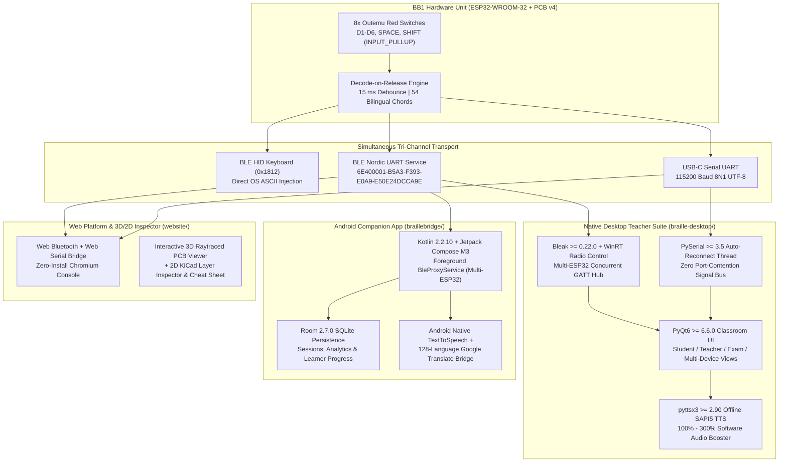

### 8.2 Native Desktop Teacher Suite (Python / PyQt6 / Bleak / WinRT / PySerial)

Located in `braille-desktop/`, the **BrailleBridge Desktop Teacher Suite** is a native Windows/Linux/macOS application engineered for classroom invigilation, blind-student self-study, and multi-student exam monitoring without requiring a browser:

- **Asynchronous BLE NUS + WinRT Radio Stack (`ble_manager.py`)**: Built on **`Bleak >= 0.22.0`** running inside a dedicated `asyncio` background thread bridged to PyQt6 `pyqtSignal` slots. On Windows 10/11, the suite integrates **`winrt-Windows.Devices.Radios`** to query and programmatically power on the host Bluetooth adapter if disabled.
- **Hot-Plug Multi-Threaded Serial Relay (`serial_manager.py`)**: Built on **`PySerial >= 3.5`**, featuring automatic ESP32 USB-UART (`CP210x` / `CH340`) port discovery and background reconnection if a cable is bumped during an examination.
- **Zero Port-Contention Multi-View Architecture (`main_window.py`)**: Unlike browser tabs that lock a single COM port or GATT connection, the PyQt6 signal bus broadcasts incoming `KEY:<char>|BITS:<6b>` frames simultaneously across **Student View**, **Teacher Dashboard**, **Interactive Learner Curriculum**, and **Exam Invigilation Mode**.
- **Concurrent Multi-ESP32 Classroom Hub**: Hardware-verified with multiple simultaneous BrailleBridge units (`BrailleBridge 2`, `BrailleBridge 3`, etc.) streaming independent student telemetry into a single teacher workstation.
- **Offline Speech Synthesis with 300% Classroom Booster (`tts_manager.py`)**: Uses **`pyttsx3 >= 2.90`** for zero-latency offline speech synthesis (character, word, and UI focus announcements) paired with a software gain booster (`100%` to `300%`) for noisy classrooms.
- **128-Language Live Translation & Auto-Saved Session Logs (`translator.py`, `session_logger.py`)**: Translates English or Bharati Bangla Braille prose into **128 target languages** in real time and automatically persists timestamped examination transcripts to disk.

### 8.3 Android Companion Application (Kotlin 2.2 / Jetpack Compose / Room)

Located in `braillebridge/`, the native Android application brings full wireless BrailleBridge functionality to smartphones and low-cost classroom tablets:

- **Modern Kotlin & Jetpack Compose Architecture**: Built with **Kotlin `2.2.10`**, **Jetpack Compose (`BOM 2024.09.00`)**, **Material 3**, and **Kotlin Coroutines (`1.10.1`)** under a clean MVVM + Repository pattern (`ui/`, `ble/`, `core/`, `data/`).
- **Foreground `BleProxyService` for Multi-Device GATT Streaming**: Maintains persistent background BLE NUS connections (`6E400001-B5A3-F393-E0A9-E50E24DCCA9E`) across multiple ESP32 units simultaneously with automatic exponential-backoff reconnection and RSSI telemetry.
- **Shared Chording & Learner Engine (`BrailleTranslationEngine.kt`, `LearnerEngine.kt`)**: Ports the exact 54-entry bilingual Grade 1 English and Bharati Bangla lookup tables, multi-cell chord sequence validator, and interactive flashcard curriculum to Kotlin, verified by automated JUnit unit tests in GitHub Actions CI (`.github/workflows/android-release.yml`).
- **Offline Room `2.7.0` SQLite Database (`KSP 2.3.7`)**: Persists student typing sessions, WPM/accuracy metrics, and curriculum mastery locally on the device.

### 8.4 Web Platform, Interactive 3D/2D PCB Inspector & Virtual Chord Pad

Located in `website/` (deployed at **[brailebridge.vercel.app](https://brailebridge.vercel.app/)**), the zero-install web platform provides:

- **Web Bluetooth & Web Serial Hardware Console**: Connects directly to the BB1 ESP32 from Chrome or Edge over BLE NUS or USB Serial (`115200` baud).
- **Interactive 6-Dot Virtual Chord Pad & Keyboard Simulator**: Allows anyone to test 6-dot English and Bharati Bangla chording in the browser using mouse/touch or standard keyboard home-row keys (`F D S` = Dots `1 2 3`, `J K L` = Dots `4 5 6`).
- **Interactive 3D Raytraced PCB Viewer & 2D KiCad Layer Inspector**: Embedded 3D tilt/perspective inspector (`view_iso_3d.png`, `view_top_3d.png`, `view_bottom_3d.png`, `view_esp32_3d.png`) and toggleable 2D copper/silkscreen layer viewer (`website/assets/pcb/pcb_2d_kicad.svg`).
- **Printable A4 Bilingual Braille Cheat Sheet (`website/cheat_sheet.html`)**: Sighted-teacher and student reference sheet containing all 54 English and Bharati Bangla dot patterns, shifted vowel signs (`কার`), numerals, and hardware chord shortcuts.

---

## 9. Repository Structure

```text
braille.bridge/
├── braile/                                    # ESP32 Bare-Metal Firmware (C++17 / Arduino Core)
│   ├── braile.ino                             # Decode-on-release state machine & 54-entry EN/BN dictionary
│   ├── BBKeyboard.h                           # Composite BLE HID + BLE Nordic UART Service header
│   └── BBKeyboard.cpp                         # Dual-GATT server & ASCII-vs-UTF-8 transport routing
│
├── hardware/                                  # Mechanical CAD & Commercial KiCad PCB Engineering
│   ├── bb1_wiring_board_v4/                   # KiCad 10 Production Carrier PCB (66.0 x 52.0 x 1.2 mm)
│   │   ├── bb1_wiring_board_v4.kicad_sch      # Full electrical schematic (0 ERC violations)
│   │   ├── bb1_wiring_board_v4.kicad_pcb      # 2-layer layout (1.0 mm power, 0.3 mm signal, 0 DRC)
│   │   ├── generate_v4.py                     # Automated programmatic schematic & PCB generator
│   │   ├── FINAL_REPORT_v4.md                 # Complete netlist, DRC/ERC & thermal verification report
│   │   └── exports/                           # Manufacturing & visual deliverables
│   │       ├── jlcpcb_gerbers_v4.zip          # Ready-to-order JLCPCB Gerber + Excellon drill package
│   │       ├── bb1_wiring_board_v4.step       # 3D mechanical STEP model for CAD integration
│   │       ├── view_iso_3d.png                # Raytraced 3D isometric PCB render
│   │       ├── view_top_3d.png                # Raytraced 3D top orthographic render
│   │       ├── view_bottom_3d.png             # Raytraced 3D bottom ground-pour render
│   │       ├── view_esp32_3d.png              # Raytraced 3D power zone & socket profile
│   │       ├── view_top_2d.png                # High-resolution 2D copper & silkscreen composite
│   │       └── bb1_wiring_board_v4.svg        # Vector electrical schematic diagram
│   ├── bb1_enclosure_v3.scad                  # Parametric OpenSCAD source for the 7.1° wedge chassis
│   └── stl/                                   # Ready-to-slice 3D-printable STL parts
│       ├── bb1_v3_full_assembly.stl           # Complete assembled reference geometry
│       ├── bb1_v3_bottom_body.stl             # Lower wedge chassis with PCB standoffs & battery bay
│       ├── bb1_v3_top_plate.stl               # 8-switch MX plate (14 x 14 mm cutouts) & rear hinge
│       └── bb1_v3_battery_cover.stl           # Tool-free underside 4xAA drop-out hatch cover
│
├── braille-desktop/                           # Native Desktop Teacher Suite (Python 3.11+ / PyQt6)
│   ├── main.py                                # Application entry point & high-DPI theme loader
│   ├── main_window.py                         # Multi-view classroom dashboard & signal router
│   ├── ble_manager.py                         # Async Bleak BLE NUS client + WinRT radio activation
│   ├── serial_manager.py                      # Multi-threaded PySerial COM relay with auto-reconnect
│   ├── braille_Lookup.py                      # Bilingual EN/BN chord decoder & Learner curriculum
│   ├── tts_manager.py                         # Offline pyttsx3 SAPI5 engine + 300% gain booster
│   ├── translator.py                          # 128-language real-time translation bridge
│   ├── session_logger.py                      # Automatic timestamped exam & practice transcript logger
│   └── requirements.txt                       # Python dependencies (PyQt6, bleak, pyserial, pyttsx3)
│
├── braillebridge/                             # Native Android Companion App (Kotlin 2.2 / Compose)
│   ├── app/src/main/java/com/braillebridge/   # MVVM UI, Foreground BleProxyService, Room 2.7 DB
│   ├── app/src/test/                          # JUnit automated chord & LearnerEngine verification suite
│   └── gradle/libs.versions.toml              # Version catalog (Kotlin 2.2.10, Compose 2024.09.00)
│
├── website/                                   # Live Web Platform, 3D/2D PCB Viewers & SEO/GEO Assets
│   ├── index.html                             # Main web platform & hardware/software showcase
│   ├── cheat_sheet.html                       # Printable A4 Grade 1 English & Bharati Bangla reference
│   ├── llms.txt                               # Structured AI/LLM entity & technical specification manifest
│   ├── sitemap.xml                            # Search engine & AI crawler route map
│   └── robots.txt                             # Crawler permissions (OAI-SearchBot, GPTBot, ClaudeBot)
│
├── mintlify-docs/                             # Hosted Engineering Documentation (solez-ai.mintlify.app)
├── BrailleBridge_Technical_Documentation.pdf  # Comprehensive System Architecture Monograph
└── BrailleBridge_Engineering_Design_Choices.pdf # Hardware, PCB v4 & Firmware Trade-Off Analysis
```

---

## 10. Build, Flash & Fabrication Guide

### 10.1 Flashing the ESP32 Firmware (`braile/`)

1. Install **Arduino IDE 2.x** and add the Espressif **ESP32 Board Manager (`v2.0.17`)**.
2. Install the **`ESP32 BLE Keyboard`** library (`T-vK / ESP32-BLE-Keyboard`).
3. Open `braile/braile.ino`, select board **`ESP32 Dev Module`**, set Partition Scheme to **`Huge APP (3MB No OTA / 1MB SPIFFS)`**, and upload at `921600` baud.
4. Open the Serial Monitor at **`115200` baud**; on boot the ESP32 advertises over Bluetooth Low Energy as **`BrailleBridge`** and outputs `BrailleBridge Ready (EN Mode)`.

### 10.2 Running the Native Desktop Teacher Suite (`braille-desktop/`)

```bash
cd braille-desktop
python -m venv .venv
# Windows PowerShell:
.\.venv\Scripts\Activate.ps1
# Linux / macOS:
# source .venv/bin/activate

pip install -r requirements.txt
python main.py
```

### 10.3 Building the Android Companion App (`braillebridge/`)

```bash
cd braillebridge
./gradlew testDebugUnitTest assembleDebug
# Output APK: app/build/outputs/apk/debug/app-debug.apk
```

### 10.4 Ordering the BB1 Wiring Board v4 PCB & 3D Printing the Enclosure

- **JLCPCB Instant Fabrication**: Upload `hardware/bb1_wiring_board_v4/exports/jlcpcb_gerbers_v4.zip` directly to [JLCPCB](https://jlcpcb.com/). Select **2 Layers**, **`66.0 × 52.0 mm`**, **`1.2 mm` thickness**, **Lead-Free HASL**, and **1 oz copper** (~$2 USD for 5 boards).
- **FDM 3D Printing (`hardware/stl/`)**: Slice `bb1_v3_bottom_body.stl`, `bb1_v3_top_plate.stl`, and `bb1_v3_battery_cover.stl` in **PLA** or **PETG** at `0.20 mm` layer height, `3` perimeter walls, `20%` gyroid infill, with no supports required.

---

## 11. License & Citation

BrailleBridge is open-source hardware and software released under the **[GNU General Public License v3.0 (GPL-3.0)](LICENSE)**. Schools, NGOs, ministries of education, and assistive-technology fabricators are explicitly encouraged to manufacture, localize, and deploy BrailleBridge without royalty fees.

### Author & Project Lead

- **Samin Yeasar** — Systems Architect, Hardware/PCB Designer, Firmware & Full-Stack Engineer
  - Portfolio: [solez.me](https://solez.me) · [solez.vercel.app](https://solez.vercel.app)
  - GitHub: [@solez-ai](https://github.com/solez-ai)
  - Documentation: [solez-ai.mintlify.app](https://solez-ai.mintlify.app)
  - Web Application: [brailebridge.vercel.app](https://brailebridge.vercel.app/)
